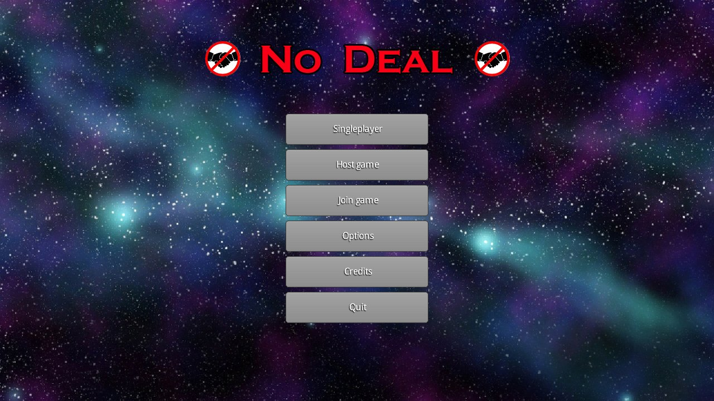
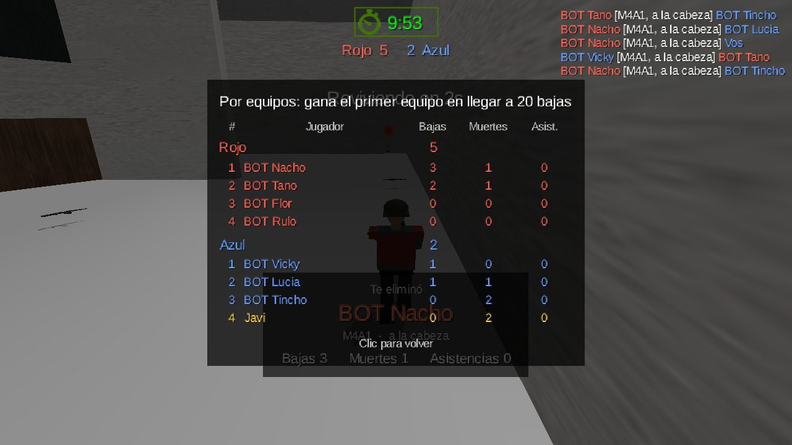
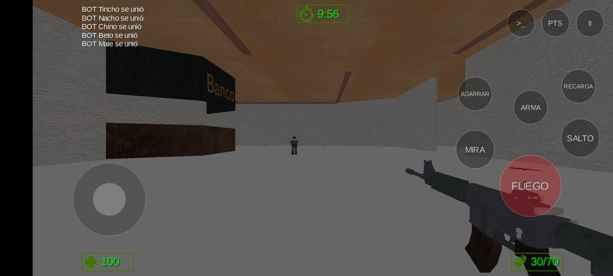
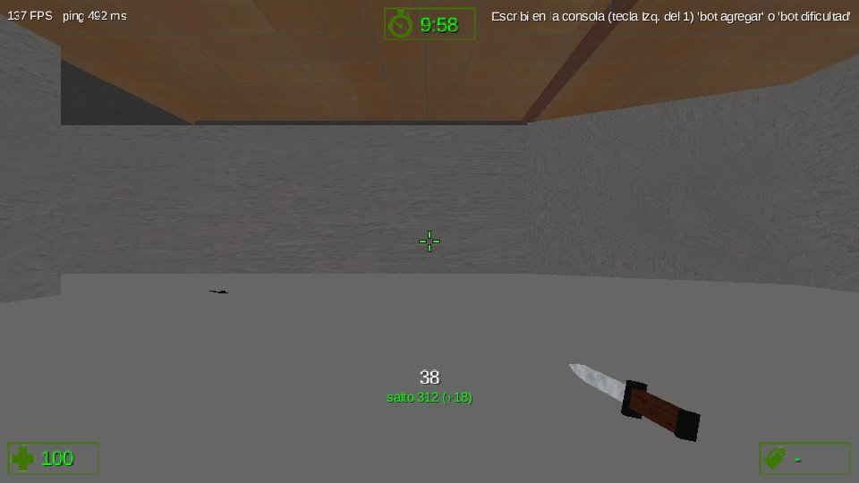
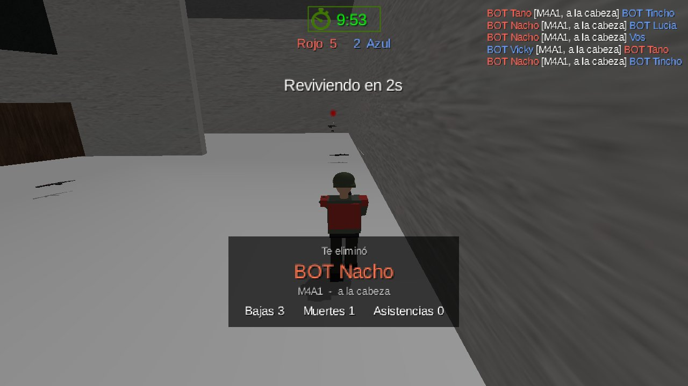
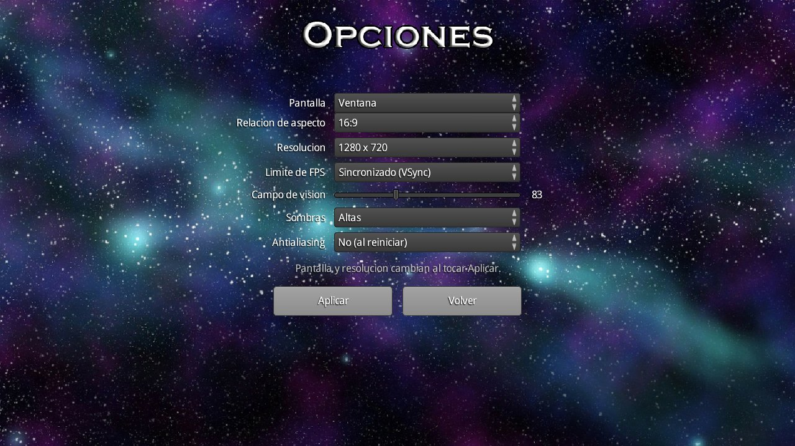

<div align="center">

# 🚫🤝 No Deal

**A fast, old-school 3D first-person shooter in the spirit of Counter-Strike 1.6, written in Java.**

Bots, LAN and Bluetooth multiplayer, team deathmatch, bunnyhop, recoil you can learn, and the same game on Windows, Linux, macOS and Android.

[](https://github.com/Ja4Dev/No-Deal/releases/latest)
[](https://github.com/Ja4Dev/No-Deal/releases)




[**Download**](#-download) · [**Features**](#-features) · [**How to play**](#-how-to-play) · [**Multiplayer**](#-multiplayer) · [**Console**](#-console-and-server-variables) · [**Build from source**](#%EF%B8%8F-building-from-source) · [**History**](#-history)

</div>

---

## 📥 Download

All builds come from the [latest release](https://github.com/Ja4Dev/No-Deal/releases/latest). The links below always point to the newest version.

| | Build | For | How to run |
| :---: | --- | --- | --- |
| 🪟 | **[NoDeal-windows.zip](https://github.com/Ja4Dev/No-Deal/releases/latest/download/NoDeal-windows.zip)** (80 MB) | Windows 10 / 11 — **recommended** | Unzip it and double-click `NoDeal.exe`. Java is included. |
| 🪟 | **[NoDeal-windows-sin-java.zip](https://github.com/Ja4Dev/No-Deal/releases/latest/download/NoDeal-windows-sin-java.zip)** (52 MB) | Windows with Java 17+ already installed | Same as above. The launcher finds your Java or helps you install it. |
| ☕ | **[NoDeal.jar](https://github.com/Ja4Dev/No-Deal/releases/latest/download/NoDeal.jar)** (36 MB) | Windows, Linux, macOS | `java -jar NoDeal.jar` with [Java 17+](https://adoptium.net/). On macOS: `java -XstartOnFirstThread -jar NoDeal.jar`. |
| 🤖 | **[NoDeal-android.apk](https://github.com/Ja4Dev/No-Deal/releases/latest/download/NoDeal-android.apk)** (35 MB) | Android 8.0+ phones and tablets | Open the file on the phone and allow *install unknown apps*. |
| 🖥️ | **[NoDeal-server.jar](https://github.com/Ja4Dev/No-Deal/releases/latest/download/NoDeal-server.jar)** (16 MB) | Any PC or VPS (no GPU needed) | Double-click it for the server window, or `java -jar NoDeal-server.jar --nogui`. |
| 🍎 | iPhone / iPad | iOS | Not published yet: it has to be built on a Mac ([see below](#phones-and-tablets)). |

> [!IMPORTANT]
> To play together, everyone needs the **same version**: the PC game, the phone app and the server. The game refuses older versions with an *incompatible version* message. The current network protocol is **v10**.

<details>
<summary><b>The game doesn't start on Windows?</b></summary>

- Extract the zip first. Opening `NoDeal.exe` from inside the zip doesn't work, and the launcher tells you so.
- If it closes with an error, the launcher comes back and explains it: Java too old, video drivers, out of memory, antivirus blocking native libraries, a crash. It shows the end of the log, with buttons to open it, copy it or try again.
- The logs are in `%LOCALAPPDATA%\NoDeal\logs` (`cliente.log`, `servidor.log`).

</details>

---

## ✨ Features

<table>
<tr>
<td width="50%"></td>
<td width="50%"></td>
</tr>
<tr>
<td align="center"><b>Team deathmatch:</b> Red against Blue, with a scoreboard grouped by team</td>
<td align="center"><b>Android:</b> the same game with touch controls, playing against PCs</td>
</tr>
<tr>
<td></td>
<td></td>
</tr>
<tr>
<td align="center"><b>Knife, speedometer and FPS:</b> <code>cl_showspeed 1</code> while bunnyhopping</td>
<td align="center"><b>Death camera:</b> follows whoever killed you, with their stats</td>
</tr>
</table>

### 🎯 Gameplay
- **Recoil like CS 1.6.** Each gun has a fixed spray pattern you can learn to pull against. Running and jumping make you inaccurate; crouching makes you steadier.
- **CS movement.** Acceleration, friction, air strafing and **bunnyhop**, with CS's own units and mouse scale, so your CS sensitivity feels the same.
- **Weapons:** M4A1, AK-47, Magnum and a **knife** (a slash and a stab, and a stab in the back kills). Switch with `1` `2` `3`, the mouse wheel, or `Q` for the last weapon used.
- **Weapon weight:** 250 speed with the knife, 240 with the pistol, 235 with the rifles.
- **Damage that drops with distance**, 4× headshots, **fall damage** that follows gravity, assists, and blood you can see and hear.
- **Guns on the ground:** drop yours and pick up others with `G`. AK-47s respawn around the map.

### 👥 Modes
- **Deathmatch:** everyone against everyone.
- **Team deathmatch:** Red against Blue, with auto-balance, team spawns and optional friendly fire.
- **Singleplayer** against 1–16 bots, in either mode.

### 🤖 Bots
Four difficulties: *fácil, medio, difícil, muy difícil*. They find their way around any map without waypoints and use the same guns and physics you do. They react like people, and better or worse depending on the difficulty.

### 🌐 Multiplayer
- **Wi-Fi / LAN:** host from the game or run a dedicated server.
- **Bluetooth:** Android phones can play without any network.
- **Mixed:** phones and PCs play in the same match.

### 🖼️ Video and settings
- **Display:** window, fullscreen or borderless.
- **Resolution** by aspect ratio (4:3, 16:9, 16:10, 21:9), with **black bars or stretched**.
- **Image:** field of view, shadows (off to high), antialiasing and an FPS limit.
- **Crosshair:** fully configurable, with a live preview.
- **Controls:** every action can be rebound, the mouse wheel included.
- **Languages:** Spanish and English.

<p align="center"></p>

---

## 🎮 How to play

| Action | Key | Action | Key |
| --- | --- | --- | --- |
| Move | `W` `A` `S` `D` | Primary / pistol / knife | `1` / `2` / `3` |
| Jump | `Space` | Next / previous weapon | Wheel down / up |
| Walk (silent) | `Shift` | Last weapon used | `Q` |
| Crouch | `Ctrl` | Drop / pick up a gun | `G` |
| Fire / slash | Left click | Scoreboard | `Tab` (hold) |
| Aim / stab | Right click | Pause menu | `Esc` |
| Reload | `R` | Console | Key left of `1` |

Everything can be changed in **Options → Controls**.

**On a phone:**
- **Left thumb:** a joystick appears wherever you touch. A little walks quietly; to the edge runs.
- **Right thumb:** drag to look.
- **Buttons:** FUEGO fires (and lets you aim while dragging), MIRA, SALTO, ARMA (cycles the three weapons), RECARGA, AGARRAR and AGACHAR.

---

## 🌐 Multiplayer

| | How |
| --- | --- |
| **Host from the game** | *Crear partida*. Pick the mode, time, kill limit and bots. Others join with the IP shown on screen. |
| **Join** | *Unirse a partida*, then type the host's IP (UDP port `25559`). |
| **Bluetooth** (Android) | Host with *Conexion: Bluetooth*; the others choose *Bluetooth* and pick the phone. No pairing needed. |
| **Dedicated server** | `NoDeal-server.jar`. With no options it opens a window; with options or `--nogui` it runs in a terminal. |

```bash
java -jar NoDeal-server.jar --port 25559 --max-players 4 --mode tdm --time-limit 10 --frag-limit 20 \
     --bots 4 --bot-difficulty dificil --friendlyfire +sv_gravity 800 +sv_airaccelerate 100 --nogui
```

On Windows, `NoDeal.exe --server [options]` does the same, and the launcher's **Servidor dedicado** button opens the server window.

**Match rules:** 10 minutes or 20 kills by default, both configurable. When it ends, the scoreboard shows the winner for 10 seconds and a new match starts.

---

## 💻 Console and server variables

Open the console with the key left of `1`. It scrolls back with the wheel or `PgUp` / `PgDn`.

| Command | What it does |
| --- | --- |
| `cl_showspeed 1` | Speedometer under the crosshair, with the gain or loss of each jump |
| `cl_showfps 1` | FPS and ping |
| `fps_max 300` | FPS cap (0 follows the screen) |
| `nombre <nuevo>` | Change your name |
| `equipo rojo\|azul\|auto` | Change team (team deathmatch) |
| `bot agregar [n] [dificultad] [equipo]` | Add bots (`bot_add` works too) |
| `bot quitar [nombre\|n\|todos]` | Remove bots (`bot_kick`) |
| `bot dificultad <dificultad>` | Change every bot's difficulty (`bot_difficulty`) |
| `bot lista` | List the bots |

Run by the host or the dedicated server (typed without a value, they show the current one):

| Variable | Default | Effect |
| --- | --- | --- |
| `sv_gravity` | `800` | Gravity. Lower means higher jumps and softer falls |
| `sv_airaccelerate` | `10` | Air strafing control (bhop servers use `100`) |
| `sv_autobunnyhopping` | `0` | `1`: holding jump jumps again on landing |
| `sv_maxspeed` | `250` | Running speed with the knife; the other weapons scale with it |
| `sv_maxvelocity` | `750` | The top speed, bunnyhop included |
| `sv_falldamage` | `1` | `0` turns fall damage off |
| `mp_friendlyfire` | `0` | `1`: teammates can hurt each other |

---

## 🛠️ Building from source

Requirements: **JDK 17** or newer.

```bash
./gradlew desktop:run          # play (gradlew.bat on Windows cmd)
./gradlew server:run           # dedicated server
./gradlew test                 # unit and network tests, no window needed

./gradlew desktop:dist         # desktop/build/libs/NoDeal-1.0.jar
./gradlew server:dist          # server/build/libs/NoDeal-server-1.0.jar
./gradlew zipWindows           # build/distributions/NoDeal-1.0-windows.zip, Java included
./gradlew zipWindows -PwithoutJava   # ...-windows-sin-java.zip
./gradlew android:assembleDebug      # android/build/outputs/apk/debug/android-debug.apk
./gradlew desktop:run -Ptouch        # try the touch controls on the PC
```

<details>
<summary><b>Windows launcher (<code>NoDeal.exe</code>)</b></summary>

The zip holds `NoDeal.exe`, the game and server jars in `game/` and a trimmed Java 17 runtime in `runtime/` (built with `jlink`, 43 MB). The launcher is a window with **Jugar** and **Servidor dedicado**:

- **Finding Java:** the bundled `runtime/` first, then `JAVA_HOME`, the installers' registry keys (Oracle, Temurin, Microsoft, Zulu, Liberica, Corretto...), the `PATH`, the usual install folders, IntelliJ's `~/.jdks` and the Java runtimes Minecraft downloads. If none is Java 17 or newer, it lists what it found and why each one doesn't work, opens the Temurin download page and searches again after you install it.
- **When the game doesn't start:** it explains the error (Java too old, OpenGL drivers, out of memory, antivirus, JVM crash, damaged files, invalid server options) and shows the end of the log.
- **While the game runs** the launcher hides. It closes when you quit the game.
- **Shortcuts:** `NoDeal.exe --client` opens the game directly; `NoDeal.exe --server [options]` the server (`--nogui` for a console).

It is written in C# (`launcher/src`) and compiled with the `csc.exe` of the .NET Framework 4.x that comes with Windows 10 and 11, so it needs nothing else. Building the package needs Windows.

</details>

<details id="phones-and-tablets">
<summary><b>Phones and tablets (Android and iOS)</b></summary>

The `core` module is compiled as **Java 8** because iOS (RoboVM) only runs Java 8 bytecode. Desktop, server and Android code can use Java 17.

**Android** needs the Android SDK: Android Studio, or only the [command-line tools](https://developer.android.com/studio#command-line-tools-only) with `platforms;android-35`, `build-tools;35.0.0` and `platform-tools`. Point Gradle to it in `local.properties` (`sdk.dir=C:/Users/you/AppData/Local/Android/Sdk`) or with `ANDROID_HOME`. Without the SDK the `android` module is skipped.

```bash
./gradlew android:installDebug    # install on a phone plugged in by USB (USB debugging on)
```

**iOS** builds only on a Mac with Xcode, with [MobiVM](https://mobivm.github.io/) (RoboVM):

```bash
./gradlew ios:launchIPhoneSimulator   # simulator
./gradlew ios:launchIOSDevice         # iPhone plugged in (needs signing identity and provisioning profile)
./gradlew ios:createIPA               # .ipa for TestFlight / App Store
```

A free Apple ID (7-day signing) or an Apple Developer account is needed for a real iPhone. Set them in `ios/build.gradle` (`robovm { iosSignIdentity = ...; iosProvisioningProfile = ... }`) or with `-Probovm.iosSignIdentity=...`.

</details>

---

## 🧩 Under the hood

<details>
<summary><b>Architecture (Entity Component System)</b></summary>

The game uses [Ashley](https://github.com/libgdx/ashley): components only hold data, and each system owns one job.

| System | Responsibility |
| --- | --- |
| `RenderSystem` | Draws the world, the shadows and the gun view model with its own camera, after every other system |
| `BulletSystem` | Steps the Bullet physics world at a fixed 60 Hz; the camera is interpolated between steps |
| `NetworkSystem` | Syncs the match with the server, moves the other players |
| `PlayerSystem` | Mouse look, CS-style movement, jumping, falls, respawning |
| `WeaponSystem` | Hitscan shooting with spray recoil, knife, reloading, switching, zoom, tracers, view model bob and kick |
| `GroundWeaponSystem` | Guns on the ground: dropping and picking up (the server decides) |
| `FootstepSystem` | Your footsteps and everyone else's, panned and fading with distance |
| `DeathCamSystem` | While dead, a camera that follows whoever killed you |
| `HudSystem` | HUD, crosshair, pause menu, console, scoreboard, damage feedback, death screen |

- **Every match runs on a `GameServer`**, singleplayer included, so bots, guns, kills and respawns work the same alone and online.
- **The player systems don't call each other.** They share state through `PlayerComponent`.
- **Guns are data:** [`core/assets/data/guns.json`](core/assets/data/guns.json) defines damage, magazine, fire rate, spray pattern, inaccuracy, weight, model and sound, so adding a gun needs no code.
- **Settings and bindings** are kept in libGDX `Preferences`. The same settings pages work from the main menu and mid-match (`SettingsFlow`).
- **Assets** go through a reference-counted `AssetManager` (`Assets.acquire` / `Assets.release`).
- **All text** is in `Text.java`, Spanish and English side by side. `TextTest` checks that both languages match.

</details>

<details>
<summary><b>Networking</b></summary>

A hand-written UDP protocol, with no networking library.

```
   client (game)                                server (in-game host or dedicated)
 ┌───────────────┐   PLAYER_STATE 30 Hz (unreliable)   ┌──────────────────────────┐
 │ NetworkSystem │ ──────────────────────────────────► │ GameServer               │
 │   GameClient  │   FIRE (reliable)                   │  - MovementValidator     │
 │               │ ──────────────────────────────────► │  - hitscan vs. level +   │
 │               │   SNAPSHOT 20 Hz (unreliable)       │    player hitboxes       │
 │               │ ◄────────────────────────────────── │  - health, kills, teams  │
 │               │   JOIN/LEAVE/KILL/RESPAWN (reliable)│  - respawns              │
 └───────────────┘ ◄────────────────────────────────── └──────────────────────────┘
```

- **Who decides what.**
  - Each client simulates its own movement, so it feels instant. The server checks each reported position against the speed limits and the client's clock.
  - Shots, knife hits, falls, health, kills and respawns are decided by the server.
- **Two channels over one socket** (`Connection`).
  - State goes *unreliably*; events go on a *reliable, ordered* channel with cumulative acks.
  - `ConnectionTest` checks it over a link that loses 30% of the packets, duplicates 10% and shuffles the rest.
- **Transports.**
  - `GameServer` and `GameClient` talk through a `Transport`: a UDP socket, or Bluetooth RFCOMM streams on Android (`LinkTransport`, `AndroidBluetooth`).
  - The host listens on both at once (`MultiTransport`).
- **Smooth remote players.** They are drawn 100 ms in the past, blending between snapshots.
- **Headless server.** `MapCollision` builds the level's collision straight from the `.g3dj` data, so the dedicated server needs no OpenGL. Spawns live in `core/assets/data/maps/<level>.json`, with optional `teamSpawns`.

Known limitations:
- There is no lag compensation, which is fine on LAN.
- The server doesn't check movement against walls.
- Players can walk through each other.

</details>

<details>
<summary><b>Bots</b></summary>

- **Same rules as people.** A `Bot` walks with the same physics body and movement code as the player, and shoots with the same gun data and server-side hit detection.
- **Human limits by difficulty** (`BotDifficulty`):
  - Reaction time goes from 0.75 s down to 0.17 s.
  - Difficulty also sets how fast and how precisely they aim, how well they control the spray, how often they go for the head, their field of view and how they move in a fight.
  - They hear gunfire and walk towards it.
- **Navigation without waypoints.**
  - `NavGrid` samples the level's collision mesh on a 2-unit grid, which takes about 0.4 s for the Bank.
  - Bots plan routes with A*, cut corners where they can, and find another way when stuck.
- **Tested.** `BotTest` runs bots on the real level. `BotServerTest` and `TeamBotTest` add them to a real server and check what a client sees.

</details>

<details>
<summary><b>The details that make it feel like CS</b></summary>

- **Recoil.**
  - Each gun has a fixed spray pattern (`spray` in `guns.json`).
  - The view climbs half of it and the bullets all of it. A crosshair set to follow the recoil climbs the other half, so it always marks the next bullet.
  - On top of the pattern there is a random inaccuracy, which depends on moving, jumping and crouching (`Recoil`).
- **Movement** (`PlayerMovement`).
  - Full speed in about 0.2 s and a full stop in about 0.25 s.
  - The mouse uses CS's scale: 0.022° per count.
  - Air acceleration is worked out in 1/120 s steps, as CS behaves at 100+ fps.
  - Eight perfect hops take you from 12 to about 30 units per second.
- **Damage over distance.** Each gun keeps a fraction of its damage every 50 units: 85% for the M4, 90% for the AK-47 and 75% for the Magnum.
- **Fall damage.** It goes by landing speed: about three times your height starts to hurt and about nine kills, at normal gravity.
- **Knife.**
  - Slash: 34 damage, every 0.4 s.
  - Stab: 65 damage, every second, with shorter reach.
  - From behind they do 90 and 180.
- **Team deathmatch.**
  - Newcomers join the smaller team, and bots switch sides to keep the teams within one player.
  - Each team spawns at its own end of the map.
  - A teamkill takes away a kill.
  - Changing team doesn't count as a death.
- **Soldiers.**
  - Low-poly soldiers built in code (`SoldierModel`), wearing team colors.
  - The legs walk as fast as the player moves, and the arms and head follow where they aim.
  - The hitbox matches the model (`CharacterShape.HITBOX_RADIUS`).

</details>

---

## 📜 History

No Deal began in **2020** as my final project for technical high school: a first-person shooter built on the *"Building a 3D Game with LibGDX"* book by Sebastián Di Giuseppe, adapted to a newer libGDX (gravity on the Y axis, my own HUD and many fixes). Back then it had movement, physics, raycast shooting, model loading, a music player, simple bots, menus and a HUD, but it couldn't be finished.

In **2026** it was brought back to life:
- **Engine update:** libGDX 1.9.10 / Java 8 → 1.13.1 / Java 17.
- **What the 2020 version was missing:** multiplayer, directional sound, player models, timed matches, scoreboard, sky, bullet holes and saved settings.
- **New:** guns on the ground, smart bots, Android, Bluetooth, bunnyhop, the knife, video options and team deathmatch.

## 🙏 Credits

- Code and design: **Javier Leone** ([@Ja4Dev](https://github.com/Ja4Dev)).
- Footstep and hit sounds: [Impact Sounds](https://kenney.nl/assets/impact-sounds) by Kenney (CC0), converted to mono WAV so they can be panned.
- Built with [libGDX](https://libgdx.com/), [Ashley](https://github.com/libgdx/ashley) and [Bullet](https://pybullet.org/).

<div align="center">

**If you like it, give the project a ⭐ and share it with anyone making a 3D game in Java.**

[⬇️ Download the latest version](https://github.com/Ja4Dev/No-Deal/releases/latest)

</div>
